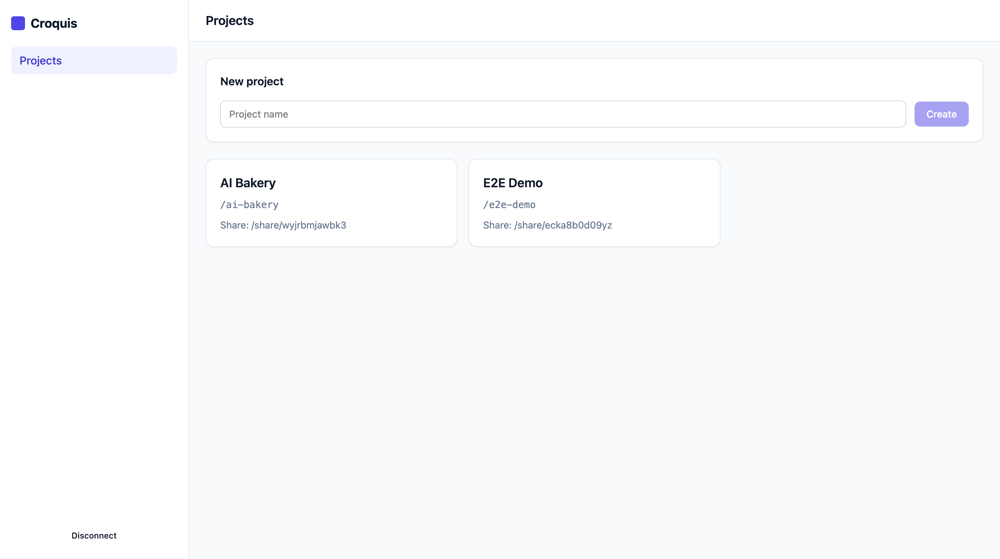
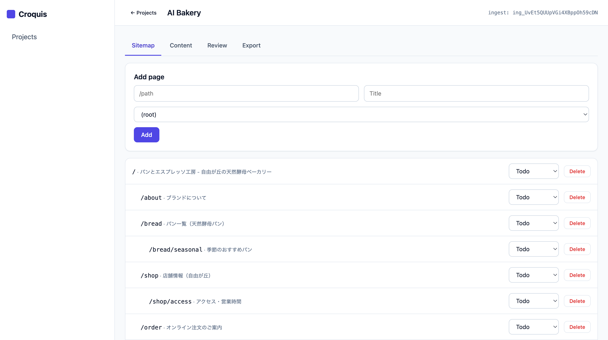
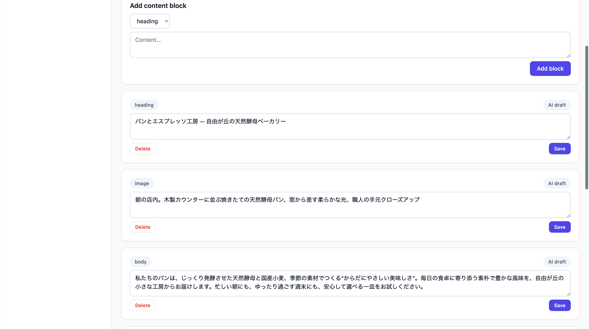
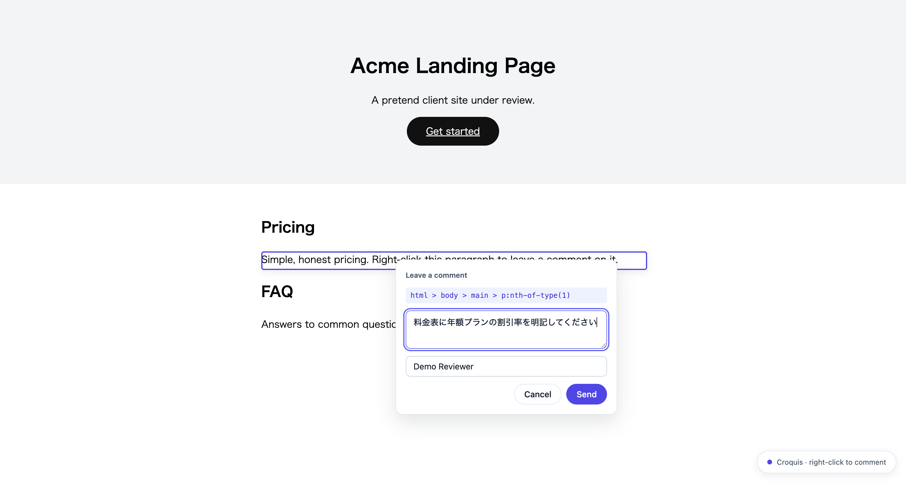
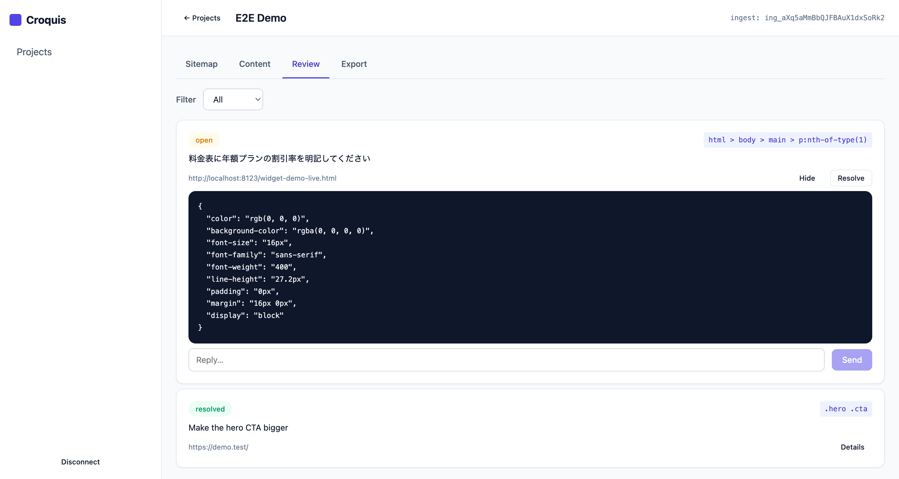
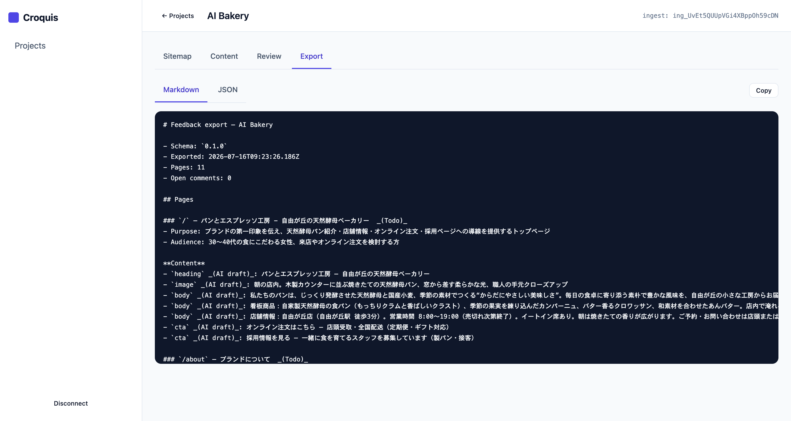

# Croquis 使い方ガイド（日本語）

Croquis（クロッキー）は、**サイトマップ → コンテンツ → レビュー**を「ページ」単位で統合する、セルフホスト型の Web 制作プラットフォームです。Cloudflare（Workers + D1 + R2）上で動き、MCP サーバー経由で Claude Code から全操作できます。

- 対象リポジトリ: https://github.com/humbulls/croquis
- English: [README.md](../README.md)

---

## 1. ローカルで動かす（5分）

前提: Node.js 22 以上 / pnpm 10 以上。

```bash
git clone https://github.com/humbulls/croquis && cd croquis
pnpm install
pnpm build                      # デザイントークン生成 → 全パッケージビルド

# ── ターミナル A: API ──
cd packages/api
cp .dev.vars.example .dev.vars  # ADMIN_TOKEN を好きな値に変更
pnpm migrate:local              # ローカル D1 にマイグレーション適用
pnpm dev                        # → http://localhost:8787

# ── ターミナル B: ダッシュボード ──
pnpm dev:dashboard              # → http://localhost:5173
```

ブラウザで `http://localhost:5173` を開き、**API URL**（`http://localhost:8787`）と **Admin token**（`.dev.vars` の値)で接続します。



## 2. プロジェクトを作る

「New project」に案件名を入れて **Create**。このとき表示される3つの値を控えてください:

| 値 | 用途 | 扱い |
|---|---|---|
| `api_token` | プロジェクト操作（MCP等） | **一度しか表示されない**。秘密 |
| `ingest_key` | ウィジェットの書込専用キー | 公開ページに埋めてOK |
| `share_slug` | クライアント向け閲覧リンク | 公開してOK（パスワード付与可） |

## 3. サイトマップを作る（手動 or AI）

**Sitemap タブ**でページを追加します。親ページを選べば階層になります。各ページには title / purpose / audience / status（Todo→In progress→In review→Done）を持たせられます。

AI に下書きさせる場合（要 AI プロバイダ設定 → §7）:

```bash
curl -X POST $API/projects/$PROJECT_ID/ai/sitemap \
  -H "Authorization: Bearer $TOKEN" -H "Content-Type: application/json" \
  -d '{"brief":"自由が丘の小さなベーカリーのブランドサイト。パン紹介、店舗情報、オンライン注文、採用。"}'
```

一段落のブリーフから階層付きのページツリーが生成・挿入されます:



## 4. コンテンツを書く（手動 or AI）

**Content タブ**でページを選び、ブロック（heading / body / image / cta）を追加・編集します。`POST /ai/content` で AI 下書きも可能（`AI draft` バッジ付きで挿入されます）:



## 5. ウィジェットでレビューを受ける

ビルド済みの `packages/widget/dist/croquis-widget.js` を、レビューさせたいページに1行で設置します:

```html
<script
  src="/path/to/croquis-widget.js"
  data-croquis-api="https://あなたのAPI.workers.dev"
  data-croquis-ingest-key="ing_…"
></script>
```

レビュアーは**ページ上の任意の要素を右クリック**するとコメントフォームが開きます（Shift+右クリックでブラウザ標準メニュー）。コメントには CSS セレクタ・computed style・直前の見出し文脈・ビューポート等が自動で添付されます:



## 6. レビューをさばく

**Review タブ**でコメントを一覧（open / resolved でフィルタ）。Details で対象要素のスタイルやスレッドを確認し、返信・解決できます:



クライアントに進捗を見せたいときは共有リンクを渡します（読み取り専用・キー非公開）:

```
GET https://あなたのAPI.workers.dev/share/<share_slug>
```

## 7. AI 機能を有効にする

API に環境変数（Wrangler secret / `.dev.vars`）を設定します。**どちらか1つのキーで動きます**:

| 変数 | 意味 |
|---|---|
| `ANTHROPIC_API_KEY` または `OPENAI_API_KEY` | AI エンドポイント有効化（未設定なら 501） |
| `AI_PROVIDER` | `anthropic` / `openai` の強制指定（省略時は見つかったキー） |
| `AI_MODEL` | モデル上書き（既定: `claude-sonnet-5` / `gpt-5-mini`） |

エンドポイント: `POST /ai/sitemap`（構成案生成）・`POST /ai/content`（原稿生成）・`GET /ai/digest`（未解決コメントの優先度付きダイジェスト）。

## 8. Claude Code から操作する（MCP）

```jsonc
// .mcp.json
{
  "mcpServers": {
    "croquis": {
      "command": "node",
      "args": ["<repo>/packages/mcp/dist/index.js"],
      "env": {
        "CROQUIS_API_URL": "https://あなたのAPI.workers.dev",
        "CROQUIS_TOKEN": "<admin または project の token>"
      }
    }
  }
}
```

17 ツール（一覧・作成・更新・解決・返信・JSON/Markdown エクスポート・AI 生成）が使えます。プロンプト例:

> 「未解決のレビューコメントを一覧して、コードを直して、終わったら resolve して」
> 「ベーカリーサイトのサイトマップを生成して、トップページの原稿も下書きして」

**Export タブ**（または `croquis_export_project_markdown`）で、プロジェクト全体を LLM に渡せる Markdown として取り出せます:



## 9. Cloudflare 本番デプロイ

```bash
cd packages/api
wrangler d1 create croquis            # 出力された database_id を wrangler.jsonc に記入
wrangler r2 bucket create croquis-screenshots
wrangler d1 migrations apply croquis --remote
wrangler secret put ADMIN_TOKEN
wrangler deploy
```

ダッシュボードは `pnpm --filter @croquis/dashboard build` → `packages/dashboard/dist` を Cloudflare Pages 等の静的ホスティングへ。ウィジェット JS も任意の静的ホスト / R2 から配信できます。本番では `DASHBOARD_ORIGIN` をダッシュボードのオリジンに設定してください（widget/share には影響しません）。

## トラブルシューティング

| 症状 | 確認すること |
|---|---|
| ダッシュボードが接続できない | API URL・ADMIN_TOKEN、API 側の起動ログ |
| ウィジェットからコメントが届かない | `data-croquis-api` と `data-croquis-ingest-key`、ブラウザの Network タブ（CORS preflight → POST 201） |
| AI が 501 を返す | プロバイダのキー未設定（§7） |
| 共有リンクが 401 | パスワード付きプロジェクト。`X-Croquis-Share-Password` ヘッダを付与 |

セキュリティ上の注意と既知の制限は [SECURITY.md](../SECURITY.md) を参照してください。
